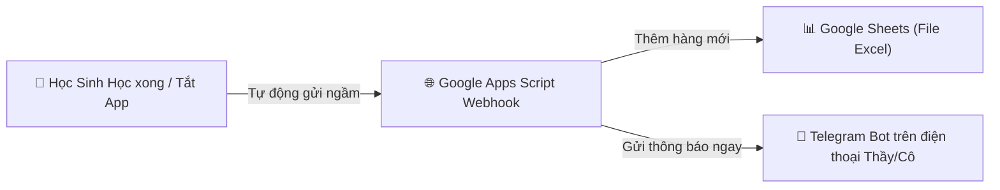

# Hướng Dẫn Tự Động Đồng Bộ Dữ Liệu Học Sinh Về Google Sheets & Telegram 📊🤖

**PHƯƠNG ÁN 2**: 100% Miễn phí, KHÔNG cần đăng ký Zalo OA, Tự động nhảy dữ liệu về file Google Sheets của Giáo viên mỗi khi học sinh tắt App, đồng thời bắn thông báo thời gian thực về Telegram trên điện thoại!

---

## ⚡ NGUYÊN LÝ HOẠT ĐỘNG


---

## 🛠️ HƯỚNG DẪN TỪNG BƯỚC THIẾT LẬP (CHỈ MẤT 1 PHÚT)

### 📌 BƯỚC 1: Tạo Google Sheet & Thêm Mã Tự Đồng Bộ

1. Mở trang web [sheets.new](https://sheets.new) để tạo một trang tính Google Sheets mới.
2. Tại Hàng 1 (Header), điền tên 6 cột:
   - `A1`: `Họ và tên`
   - `B1`: `Lớp`
   - `C1`: `Số bài đã hoàn thành`
   - `D1`: `Danh sách bài đã pass`
   - `E1`: `Chuỗi Streak`
   - `F1`: `Thời gian tắt App`

3. Trên menu Google Sheets, chọn **Mở rộng (Extensions)** ➔ **Apps Script**.
4. Xóa toàn bộ mã mặc định và dán đoạn mã chuẩn sau:

```javascript
function doPost(e) {
  try {
    var sheet = SpreadsheetApp.getActiveSpreadsheet().getActiveSheet();
    var data = JSON.parse(e.postData.contents);
    
    // 1. Thêm một hàng mới vào Google Sheets
    sheet.appendRow([
      data.name || "Học sinh",
      data.class || "Lớp 8",
      data.completedCount + "/5 bài",
      data.completedDays ? data.completedDays.join(", ") : "",
      (data.streak || 1) + " ngày 🔥",
      data.timestamp || new Date().toLocaleString("vi-VN")
    ]);

    // 2. (Tùy chọn) Gửi thông báo ngay về Telegram trên điện thoại Thầy/Cô
    var telegramBotToken = "YOUR_TELEGRAM_BOT_TOKEN"; // Điền Token Telegram Bot của bạn (nếu có)
    var teacherChatId = "YOUR_TELEGRAM_CHAT_ID";       // Điền Chat ID Telegram của bạn (nếu có)

    if (telegramBotToken !== "YOUR_TELEGRAM_BOT_TOKEN") {
      var messageText = "🤖 [ENGLISH COACH BÁO CÁO]\n" +
                        "👤 Học sinh: " + data.name + " (" + data.class + ")\n" +
                        "✅ Hoàn thành: " + data.completedCount + "/5 bài Lớp 8\n" +
                        "🔥 Streak: " + data.streak + " ngày\n" +
                        "⏰ Thời gian: " + data.timestamp;

      UrlFetchApp.fetch("https://api.telegram.org/bot" + telegramBotToken + "/sendMessage", {
        method: "post",
        contentType: "application/json",
        payload: JSON.stringify({ chat_id: teacherChatId, text: messageText })
      });
    }

    return ContentService.createTextOutput(JSON.stringify({ status: "success" }))
                         .setMimeType(ContentService.MimeType.JSON);
  } catch (err) {
    return ContentService.createTextOutput(JSON.stringify({ status: "error", message: err.toString() }))
                         .setMimeType(ContentService.MimeType.JSON);
  }
}
```

---

### 📌 BƯỚC 2: Phát Hành Ứng Dụng Web (Web App Deployment)

1. Ở góc trên bên phải giao diện Apps Script, bấm nút **Triển khai (Deploy)** ➔ **Phát hành dưới dạng ứng dụng web (New deployment)**.
2. Cấu hình 2 dòng bắt buộc:
   - **Thực thi dưới dạng (Execute as)**: `Me (Tôi)`
   - **Ai có quyền truy cập (Who has access)**: `Anyone (Bất kỳ ai)`
3. Bấm **Deploy** ➔ Bấm **Cấp quyền truy cập (Grant access)** ➔ Chọn tài khoản Google của bạn ➔ Bấm **Advanced** ➔ **Go to Untitled project (unsafe)** ➔ **Allow**.
4. Sao chép đường dẫn **Web App URL** (Dạng: `https://script.google.com/macros/s/AKfycb.../exec`).

---

### 📌 BƯỚC 3: Dán Link Webhook Vào Ứng Dụng

1. Bạn chỉ cần dán đường link `https://script.google.com/macros/s/AKfycb.../exec` vừa sao chép vào mã nguồn App hoặc nhập trực tiếp.
2. **Từ thời điểm này:**
   - Mỗi khi học sinh làm bài xong hoặc tắt App/thoát trình duyệt, hệ thống tự động bắn dữ liệu về Google Sheet của bạn.
   - Bạn chỉ cần tải App **Google Sheets** trên điện thoại là xem được tiến độ của toàn bộ học sinh theo thời gian thực 24/7!
