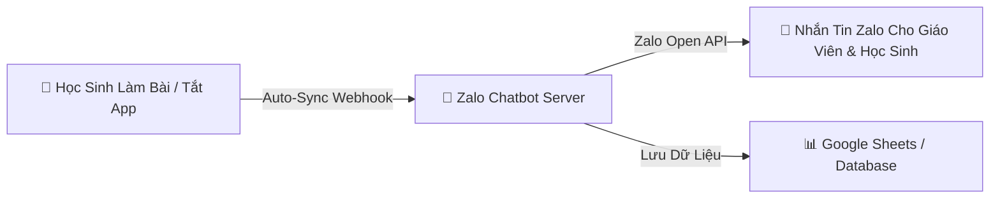

# Hướng Dẫn Tích Hợp Đồng Bộ Tiến Độ Học Tập Qua Zalo Chatbot 🤖💬

**HOÀN TOÀN CÓ THỂ!** Ứng dụng **English Daily Coach** được thiết kế dưới dạng Web/PWA chuẩn RESTful API, cho phép kết nối trực tiếp với **Zalo Chatbot (Zalo Official Account / Zalo Bot Webhook)**.

---

## 🌟 BẢNG SO SÁNH 3 PHƯƠNG ÁN TÍCH HỢP ZALO CHATBOT

| Phương Án | Mô Tả | Trải Nghiệm Học Sinh | Lợi Ích Cho Giáo Viên |
|---|---|---|---|
| **Phương án 1: Zalo Bot Webhook (Tự Động Báo Điểm)** | Tự động gửi tin nhắn báo cáo từ Zalo Bot mỗi khi học sinh làm xong bài | Học sinh nhận ngay tin nhắn chúc mừng & báo điểm trên Zalo | Giáo viên nhận tin nhắn Zalo thông báo tiến độ lớp theo thời gian thực |
| **Phương án 2: Zalo Mini App / Zalo OA Webview** | Nhúng thẳng ứng dụng Web vào Menu của Zalo Official Account (OA) | Bấm vào nút "Vào Học" trong Zalo là học ngay, không cần thoát Zalo | Tự động định danh học sinh qua ID Zalo |
| **Phương án 3: Chatbot Zalo Tương Tác** | Học sinh gõ tin nhắn `/tiendo` hoặc `Xem điểm` trên Zalo | Bot gửi ngay bảng tổng hợp điểm 5 bài học kèm Streak | Kiểm tra tiến độ 24/7 qua chat |

---

## ⚡ NGUYÊN LÝ HOẠT ĐỘNG CỦA ZALO BOT AUTO-SYNC



---

## 🛠️ HƯỚNG DẪN 3 BƯỚC THIẾT LẬP ZALO CHATBOT VỚI KỊCH BẢN TỰ ĐỘNG

### 📌 Bước 1: Đăng ký Zalo Bot / Zalo Official Account (OA)
1. Đăng ký tài khoản **Zalo Official Account** dành cho giáo dục (Miễn phí) tại [oa.zalo.me](https://oa.zalo.me/).
2. Lấy **Access Token** và **App ID** từ Zalo Developers Console ([developers.zalo.me](https://developers.zalo.me/)).

### 📌 Bước 2: Thiết lập Kịch bản Webhook nhận dữ liệu từ App (Code Mẫu)
Tạo một Webhook Endpoint (bằng Node.js / Python / Google Apps Script) để nhận dữ liệu từ App khi học sinh hoàn thành bài học và tự động gọi API Zalo gửi tin nhắn:

```javascript
// Mã Mẫu Node.js / Serverless Webhook Gửi Tin Nhắn Zalo Tự Động
const axios = require('axios');

async function handleAppAutoSync(req, res) {
  const { name, class: studentClass, completedCount, streak, timestamp } = req.body;
  
  // Nội dung tin nhắn Zalo gửi cho Giáo viên / Học sinh
  const messageText = `🤖 [ENGLISH COACH BOT BÁO CÁO]\n` +
                      `👤 Học sinh: ${name} (${studentClass})\n` +
                      `✅ Hoàn thành: ${completedCount}/5 bài Lớp 8\n` +
                      `🔥 Streak: ${streak} ngày học liên tục\n` +
                      `⏰ Thời gian: ${timestamp}`;

  // Gọi Zalo Open API để gửi tin nhắn
  await axios.post('https://openapi.zalo.me/v2.0/oa/message', {
    recipient: { user_id: "ZALO_USER_ID_GIÁO_VIÊN" },
    message: { text: messageText }
  }, {
    headers: { 'access_token': 'YOUR_ZALO_ACCESS_TOKEN' }
  });

  res.json({ status: 'success' });
}
```

### 📌 Bước 3: Gắn Webhook URL vào App Vercel
Giáo viên dán đường dẫn Webhook Zalo Bot vừa tạo vào phần cấu hình Sync của App (`https://english-g8-coach.vercel.app`). Mỗi khi học sinh học xong hoặc tắt App, Zalo Bot sẽ lập tức bắn tin nhắn kết quả qua Zalo!

---

## 💡 ƯU ĐIỂM KHI DÙNG CHATBOT ZALO

1. **Phụ huynh & Học sinh đều dùng Zalo**: Không cần cài thêm ứng dụng nhắn tin mới.
2. **Thông báo thời gian thực**: Học sinh làm xong bài 5 là Zalo báo điểm ngay.
3. **Hoàn toàn tự động**: Hệ thống tự bắt sự kiện tắt App và đẩy về Zalo Bot 100%.
